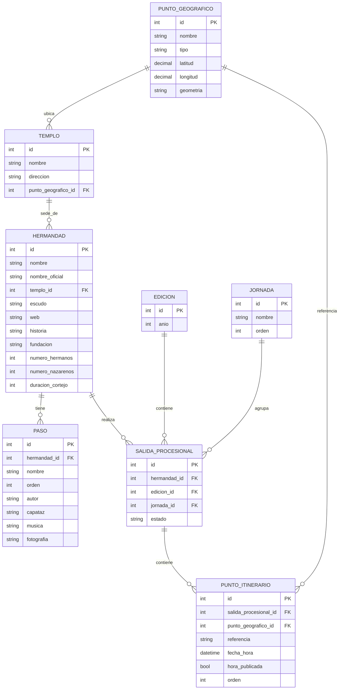

# Modelo de datos · base de trabajo

Modelo entidad-relación de ocho entidades, definido por Carlos el 15 de octubre de 2026. Es la base para transcribir los datos reales del hito **1 · Datos**. Se mantiene sencillo: solo cambia cuando haya un caso de uso concreto que lo pida.

Cada entidad es un CSV de esta carpeta, con el mismo nombre en minúsculas. Las claves son números enteros; las relaciones se rellenan con el `id` de la otra tabla.



## Decisiones

- **Hermandad y salida van separadas.** La hermandad es lo que no cambia; la salida es su estación de penitencia en una jornada de un año (`EDICION`). Los horarios de 2027 se añaden como salidas nuevas, sin tocar los de 2026.
- **Cada lugar se da de alta una sola vez** en `PUNTO_GEOGRAFICO` y lo comparten todas las hermandades. Los nombres se normalizan a mano: no hay alias.
- **`geometria`** guarda el trazado del lugar en GeoJSON (añadido el 16 de octubre de 2026 para el GPS social). Una coordenada sola no basta para saber si alguien está cerca de una calle larga: en Sierpes, una persona a 200 m del punto representativo puede estar en plena calle. `latitud` y `longitud` siguen siendo el punto representativo, el que se usa para centrar el mapa o rotular.
  - Calles y vías: `LineString`, o `MultiLineString` si la calle está partida en tramos.
  - Templos y lugares puntuales: `Point`, o vacía cuando repetiría `latitud` y `longitud`.
  - Se obtiene de OpenStreetMap con consultas automáticas y se revisan a mano las coincidencias ambiguas.
  - Una calle sigue siendo **un solo registro** aunque pasen por ella muchas hermandades.
  - La geometría es de la calle entera: **no dice qué tramo ocupa una hermandad**. Eso sale de combinarla con el orden del itinerario, los horarios y las posiciones estimadas.
- **`referencia`** dice a qué parte del cortejo corresponde la hora: `cruz_guia` o `ultimo_paso`.
- **`hora_publicada`** distingue la hora que viene del documento (`si`) de una estimada (`no`).
- **`fecha_hora`** lleva fecha y hora, porque la Madrugá cruza la medianoche: `2026-04-03T00:30` va después de `2026-04-02T23:50`.
- **`estado`** de la salida registra suspensiones o interrupciones.
- **La fuente de los datos** queda por estudiar, sin tablas nuevas.

## Cómo rellenar

| Tabla | Campo | Formato | Ejemplo |
|---|---|---|---|
| `punto_geografico.csv` | `tipo` | `calle`, `plaza`, `templo`, `puente` u `otro` | `plaza` |
| | `latitud`, `longitud` | grados decimales, 5 decimales; en calles largas, un punto del tramo por donde pasan las cofradías | `37.39170`, `-5.99490` |
| | `geometria` | solo el objeto `geometry` de GeoJSON, en una línea y entre comillas. **Ojo: GeoJSON va longitud primero** | `"{""type"":""LineString"",""coordinates"":[[-5.99490,37.39170],[-5.99460,37.39320]]}"` |
| `templo.csv` | `punto_geografico_id` | id del punto donde está el templo | `16` |
| `hermandad.csv` | `nombre` | el popular, como se usa en la app | `La Macarena` |
| | `nombre_oficial` | la denominación completa | `Real, Ilustre y Fervorosa Hermandad…` |
| `paso.csv` | `orden` | orden en el cortejo, desde 1 | `2` |
| `edicion.csv` | `anio` | cuatro cifras | `2026` |
| `jornada.csv` | `orden` | de Viernes de Dolores (1) a Domingo de Resurrección (11) | `8` para la Madrugá |
| `salida_procesional.csv` | `estado` | vacío si sale con normalidad | `suspendida` |
| `punto_itinerario.csv` | `referencia` | `cruz_guia` o `ultimo_paso` | `cruz_guia` |
| | `fecha_hora` | `AAAA-MM-DDTHH:MM` | `2026-04-03T02:30` |
| | `hora_publicada` | `si` o `no` | `si` |
| | `orden` | orden de paso dentro de la salida y la referencia, desde 1 | `7` |

Los CSV van en UTF-8, separados por comas; los textos con comas, entre comillas (y las comillas de dentro, dobladas, como en el ejemplo de `geometria`). Los datos inventados de `mock/` son solo para diseñar y no se mezclan con estos.

## Comprobar

```sh
python3 docs/datos/verificar.py
```

Revisa los ocho CSV y dice archivo, fila y columna de cada problema:

- **Errores**: un `id` repetido o que no es un número, una columna obligatoria vacía, un `*_id` que apunta a una fila que no existe, un valor fuera de los permitidos (`tipo`, `referencia`, `hora_publicada`), una `fecha_hora` mal escrita, coordenadas fuera de Sevilla, dos pasos con el mismo orden en una hermandad y horas que van hacia atrás dentro de una salida (lo normal es olvidar cambiar el día tras la medianoche).
- **Avisos**: dos puntos que parecen el mismo lugar escrito de dos formas («La Campana» y «Campana»), un templo cuyo punto no es de tipo `templo`, más de tres pasos en una hermandad o dos salidas de la misma hermandad en un año.

Los puntos sin coordenadas no son error: durante el inventario se cuentan aparte.

> **Pendiente:** `punto_geografico.csv` y el comprobador todavía no tienen la columna `geometria`. Hay que añadirla a los dos a la vez; si se añade solo al CSV, el comprobador dará error de cabecera. Ver «GPS social · pendiente».

## GPS social · concepto

**Estado: en diseño. No hay nada implementado.** «GPS social» es el nombre interno del sistema que estima dónde va cada elemento del cortejo a partir de lo que ven los usuarios, sin dispositivos en los pasos. Para el usuario, la acción es **«Dar fe»** (`design.md`, D20); «check-in» no se usa en la interfaz.

### Funcionamiento previsto

1. El usuario elige la hermandad y el elemento que está viendo: la cruz de guía o un paso concreto.
2. Cofradar toma su ubicación GPS y la hora.
3. Comprueba si está cerca del recorrido previsto y si la hora encaja con el horario publicado.
4. Si la desviación es excesiva, la aportación no se usa para la posición (ver pendiente 2).
5. Las aportaciones válidas sirven para estimar la posición real del elemento.
6. Las siguientes aportaciones se contrastan también con las posiciones ya estimadas (ver pendiente 3).
7. La cruz de guía y cada paso tienen su propia posición, independiente de las demás.

El programa oficial de horarios e itinerarios es la referencia de partida. A medida que llegan aportaciones, pesa más lo que la gente ve.

### Qué aporta cada dato del modelo

| Dato | Qué responde | Ejemplo |
|---|---|---|
| `punto_itinerario` (`orden`) | Por qué lugares pasa y en qué orden | La Macarena: … → Campana → Sierpes → Plaza de San Francisco → … |
| `punto_itinerario` (`fecha_hora`, `referencia`) | A qué hora debería estar la cruz de guía o el último paso en cada lugar | Cruz de guía en la Campana a las `2026-04-03T02:30` |
| `punto_geografico.geometria` | Si una persona está **en** ese lugar, aunque esté lejos de su punto representativo | Un usuario a mitad de Sierpes está en Sierpes |
| `paso.orden` | Qué elementos hay entre la cruz de guía y el último paso | El paso de Cristo va entre los dos |

**Ejemplo.** A las 02:50 alguien da fe del paso de Cristo de La Macarena desde la mitad de Sierpes.
- La geometría dice que está en Sierpes.
- El itinerario dice que Sierpes va después de la Campana.
- El horario pone la cruz de guía en la Campana a las 02:30 y el último paso más tarde.
- Así que es razonable que el paso de Cristo, que va entre los dos, esté en Sierpes a esa hora.

La geometría sola no lo diría: Sierpes mide varios cientos de metros, y estar en ella no dice en qué tramo va la cofradía.

**Hipótesis, no decisión:** encadenar la `geometria` de los puntos en el `orden` del itinerario daría el recorrido aproximado de cada salida. Eso es lo que el PRD llama «la línea del itinerario» en «Cómo se calcula la posición», y evitaría mantener aparte los GeoJSON por hermandad que se descartaron (BUL-169). Hay un caso que lo complica: una cofradía que solo recorre parte de una calle.

### Aprobado

- Las **ocho entidades** siguen siendo las mismas. No hay tablas nuevas de aportaciones, posiciones estimadas ni geometrías.
- `PUNTO_GEOGRAFICO` gana `geometria`, en GeoJSON, con los tipos de arriba. `latitud` y `longitud` se mantienen como punto representativo.
- **Un registro por lugar**, también con geometría.
- **Fuente de la geometría:** OpenStreetMap, con consultas automáticas y revisión manual de las coincidencias ambiguas.
- **Referencia inicial:** el horario e itinerario oficial del Consejo.
- **Cada elemento** (la cruz de guía y cada paso) tiene posición propia. Ya lo dice el PRD: «cada uno tiene posición y confianza propias».
- No cambian las decisiones sobre `referencia`, `hora_publicada`, `fecha_hora`, `EDICION`, `JORNADA` y `SALIDA_PROCESIONAL`.

### Pendiente de diseño

1. **Umbrales.** Faltan la distancia máxima al recorrido, la tolerancia horaria, los criterios de confianza y las penalizaciones. Ninguno está fijado.
2. **«Rechazar» frente al PRD.** El PRD dice tres cosas sobre esto:
   - el registro es siempre posible;
   - nunca se muestra «rechazada»;
   - el GPS es una señal, no el juez.

   La forma de encajarlo sería que una aportación con demasiada desviación **no entre en el cálculo de la posición**, pero quede en el historial del usuario con sus puntos base. Está por confirmar.
3. **Contrastar con posiciones estimadas frente al PRD.** El PRD dice que el modelo puede discrepar de una aportación, pero solo otras observaciones independientes pueden contradecirla. Si cada aportación se juzga contra la estimación, el sistema puede acabar rechazando justo la primera observación de un retraso. Falta decidir cómo se combinan las dos ideas.
4. **«Estoy viendo la cofradía», sin elemento.** El PRD (F-22) y `design.md` (D24) hacen esta opción obligatoria en el selector. Falta definir qué hace el GPS social con ella: no sitúa un elemento concreto, pero sí dice que el cortejo pasa por ahí.
5. **Sin GPS o sin conexión.** Dar fe nunca se bloquea por falta de ubicación (PRD y D30), y sin conexión se juzga con la hora de la observación (F-26). Falta concretar qué papel tienen estas aportaciones en la validación.
6. **Dónde vive la geometría.** Una `MultiLineString` dentro de una celda CSV es válida pero larga e incómoda de revisar. Falta decidir si basta así o si hace falta otra forma de guardarla, y cuánta precisión (número de vértices) se necesita.
7. **Comprobador y CSV.** Hay que añadir la columna `geometria` a `punto_geografico.csv` y a `verificar.py`, que tendría que comprobar que es GeoJSON válido, de un tipo permitido y dentro de Sevilla. No se ha hecho en esta tarea. Lo lógico es que entre en las coordenadas (BUL-168) o en una issue propia.
8. **Línea del itinerario.** Falta confirmar la hipótesis de arriba, y con ella actualizar «Cómo se calcula la posición» del PRD, que todavía habla de «punto de control».
9. **Dónde se guardan aportaciones y posiciones.** El PRD ya las nombra («Aportación»), pero no son datos que se transcriban. Su estructura se propondrá con un caso de uso concreto cuando se defina el motor.
