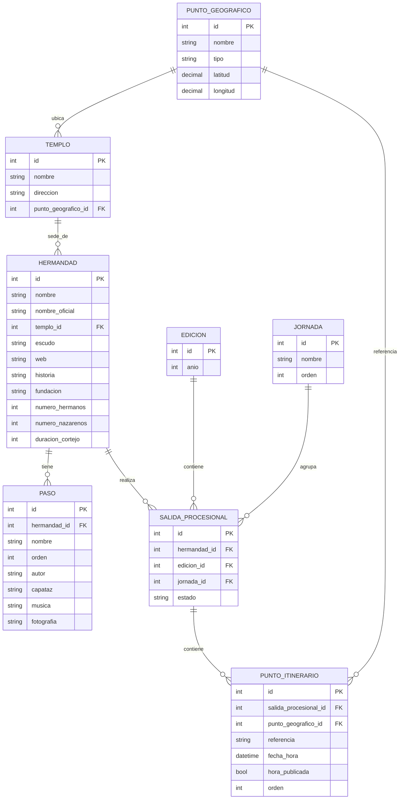

# Modelo de datos · base de trabajo

Modelo entidad-relación de ocho entidades, definido por Carlos el 15 de octubre de 2026. Es la base para transcribir los datos reales del hito **1 · Datos**. Se mantiene sencillo: solo cambia cuando haya un caso de uso concreto que lo pida.

Cada entidad es un CSV de esta carpeta, con el mismo nombre en minúsculas. Las claves son números enteros; las relaciones se rellenan con el `id` de la otra tabla.

## Decisiones

- **Hermandad y salida van separadas.** La hermandad es lo que no cambia; la salida es su estación de penitencia en una jornada de un año (`EDICION`). Los horarios de 2027 se añaden como salidas nuevas, sin tocar los de 2026.
- **Cada lugar se da de alta una sola vez** en `PUNTO_GEOGRAFICO` y lo comparten todas las hermandades. Los nombres se normalizan a mano: no hay alias.
- **`referencia`** dice a qué parte del cortejo corresponde la hora: `cruz_guia` o `ultimo_paso`.
- **`hora_publicada`** distingue la hora que viene del documento (`si`) de una estimada (`no`).
- **`fecha_hora`** lleva fecha y hora, porque la Madrugá cruza la medianoche: `2026-04-03T00:30` va después de `2026-04-02T23:50`.
- **`estado`** de la salida registra suspensiones o interrupciones.
- **La fuente de los datos** queda por estudiar, sin tablas nuevas.

## Cómo rellenar

| Tabla | Campo | Formato | Ejemplo |
|---|---|---|---|
| `punto_geografico.csv` | `tipo` | `calle`, `plaza`, `templo`, `puente` u `otro` | `plaza` |
| | `latitud`, `longitud` | grados decimales, 5 decimales | `37.39170`, `-5.99490` |
| `templo.csv` | `punto_geografico_id` | id del punto donde está el templo | `16` |
| `hermandad.csv` | `nombre` | el popular, como se usa en la app | `La Macarena` |
| | `nombre_oficial` | la denominación completa | `Real, Ilustre y Fervorosa Hermandad…` |
| `paso.csv` | `orden` | orden en el cortejo, desde 1 | `2` |
| `edicion.csv` | `anio` | cuatro cifras | `2026` |
| `jornada.csv` | `orden` | de Viernes de Dolores (1) a Domingo de Resurrección (11) | `8` para la Madrugá |
| `salida_procesional.csv` | `estado` | vacío si sale con normalidad | `suspendida` |
| `punto_itinerario.csv` | `referencia` | `cruz_guia` o `ultimo_paso` | `cruz_guia` |
| | `fecha_hora` | `AAAA-MM-DDTHH:MM` | `2026-04-03T02:30` |
| | `hora_publicada` | `si` o `no` | `si` |
| | `orden` | orden de paso dentro de la salida y la referencia, desde 1 | `7` |

Los CSV van en UTF-8, separados por comas; los textos con comas, entre comillas. Los datos inventados de `mock/` son solo para diseñar y no se mezclan con estos.
