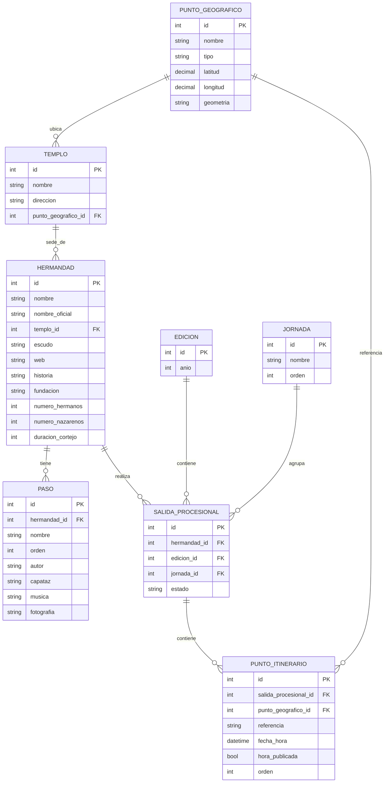
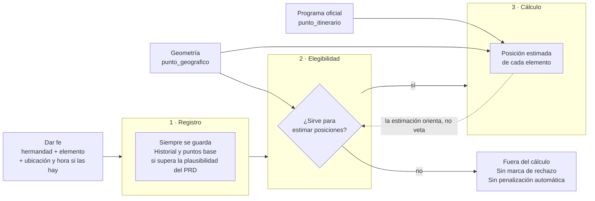

# Modelo de datos · base de trabajo

Modelo entidad-relación de ocho entidades, definido por Carlos el 15 de octubre de 2026. Es la base para transcribir los datos reales del hito **1 · Datos**. Se mantiene sencillo: solo cambia cuando haya un caso de uso concreto que lo pida.

Cada entidad es un CSV de esta carpeta, con el mismo nombre en minúsculas. Las claves son números enteros; las relaciones se rellenan con el `id` de la otra tabla.



## Decisiones

- **Hermandad y salida van separadas.** La hermandad es lo que no cambia; la salida es su estación de penitencia en una jornada de un año (`EDICION`). Los horarios de 2027 se añaden como salidas nuevas, sin tocar los de 2026.
- **Cada lugar se da de alta una sola vez** en `PUNTO_GEOGRAFICO` y lo comparten todas las hermandades. Los nombres se normalizan a mano: no hay alias.
- **`geometria`** guarda el trazado del lugar en GeoJSON (añadido el 16 de octubre de 2026 para el GPS social). Una coordenada sola no basta para saber si alguien está cerca de una calle larga: en Sierpes, una persona a 200 m del punto representativo puede estar en plena calle. `latitud` y `longitud` siguen siendo el punto representativo, el que se usa para centrar el mapa o rotular.
  - Calles y vías: `LineString`, o `MultiLineString` si la calle está partida en tramos.
  - Templos y lugares puntuales: `Point`, o vacía cuando repetiría `latitud` y `longitud`.
  - Se obtiene de OpenStreetMap con consultas automáticas y se revisan a mano las coincidencias ambiguas.
  - Una calle sigue siendo **un solo registro** aunque pasen por ella muchas hermandades.
  - La geometría es de la calle entera: **no dice qué tramo ocupa una hermandad**. Eso sale de combinarla con el orden del itinerario, los horarios y las aportaciones.
  - El almacenamiento definitivo (en la celda del CSV o en archivos asociados) está por decidir: ver «GPS social · abierto».
- **`referencia`** dice a qué parte del cortejo corresponde la hora: `cruz_guia` o `ultimo_paso`.
- **`hora_publicada`** distingue la hora que viene del documento (`si`) de una estimada (`no`).
- **`fecha_hora`** lleva fecha y hora, porque la Madrugá cruza la medianoche: `2026-04-03T00:30` va después de `2026-04-02T23:50`.
- **`estado`** de la salida registra suspensiones o interrupciones.
- **La fuente de los datos** queda por estudiar, sin tablas nuevas.

## Cómo rellenar

| Tabla | Campo | Formato | Ejemplo |
|---|---|---|---|
| `punto_geografico.csv` | `tipo` | `calle`, `plaza`, `templo`, `puente` u `otro` | `plaza` |
| | `latitud`, `longitud` | grados decimales, 5 decimales; en calles largas, un punto del tramo por donde pasan las cofradías | `37.39170`, `-5.99490` |
| | `geometria` | solo el objeto `geometry` de GeoJSON, en una línea y entre comillas. **Ojo: GeoJSON va longitud primero** | `"{""type"":""LineString"",""coordinates"":[[-5.99490,37.39170],[-5.99460,37.39320]]}"` |
| `templo.csv` | `punto_geografico_id` | id del punto donde está el templo | `16` |
| `hermandad.csv` | `nombre` | el popular, como se usa en la app | `La Macarena` |
| | `nombre_oficial` | la denominación completa | `Real, Ilustre y Fervorosa Hermandad…` |
| `paso.csv` | `orden` | orden en el cortejo, desde 1 | `2` |
| `edicion.csv` | `anio` | cuatro cifras | `2026` |
| `jornada.csv` | `orden` | de Viernes de Dolores (1) a Domingo de Resurrección (11) | `8` para la Madrugá |
| `salida_procesional.csv` | `estado` | vacío si sale con normalidad | `suspendida` |
| `punto_itinerario.csv` | `referencia` | `cruz_guia` o `ultimo_paso` | `cruz_guia` |
| | `fecha_hora` | `AAAA-MM-DDTHH:MM` | `2026-04-03T02:30` |
| | `hora_publicada` | `si` o `no` | `si` |
| | `orden` | orden de paso dentro de la salida y la referencia, desde 1 | `7` |

Los CSV van en UTF-8, separados por comas; los textos con comas, entre comillas (y las comillas de dentro, dobladas, como en el ejemplo de `geometria`). Los datos inventados de `mock/` son solo para diseñar y no se mezclan con estos.

## Comprobar

```sh
python3 docs/datos/verificar.py
```

Revisa los ocho CSV y dice archivo, fila y columna de cada problema:

- **Errores**: un `id` repetido o que no es un número, una columna obligatoria vacía, un `*_id` que apunta a una fila que no existe, un valor fuera de los permitidos (`tipo`, `referencia`, `hora_publicada`), una `fecha_hora` mal escrita, coordenadas fuera de Sevilla, dos pasos con el mismo orden en una hermandad y horas que van hacia atrás dentro de una salida (lo normal es olvidar cambiar el día tras la medianoche).
- **Avisos**: dos puntos que parecen el mismo lugar escrito de dos formas («La Campana» y «Campana»), un templo cuyo punto no es de tipo `templo`, más de tres pasos en una hermandad o dos salidas de la misma hermandad en un año.

Los puntos sin coordenadas no son error: durante el inventario se cuentan aparte.

> **Pendiente (BUL-168):** `punto_geografico.csv` y el comprobador todavía no tienen la columna `geometria`. Se añadirán a la vez en BUL-168: si se añadiera solo al CSV, el comprobador daría error de cabecera.

## GPS social · concepto

**Estado: en diseño. No hay nada implementado.** «GPS social» es el nombre interno del sistema que estima dónde va cada elemento del cortejo a partir de lo que ven los usuarios, sin dispositivos en los pasos. Para el usuario, la acción es **«Dar fe»** (`design.md`, D20); en la interfaz no se habla de «check-in».

### Principio

**El programa oficial da la previsión inicial. Las aportaciones independientes de los usuarios permiten estimar y corregir la posición real de la cruz de guía y de cada paso.**

La estimación vigente **nunca se convierte en una verdad que impida corregirla**. Una aportación que no coincide con lo estimado puede ser justo la primera que ve un retraso. Es el principio del PRD: «el modelo puede discrepar de una aportación, pero solo otras observaciones independientes pueden contradecirla».

### Tres fases que van siempre separadas



1. **Registro.** Todo «Dar fe» queda registrado con sus puntos base, como dice el PRD. Esto no depende de la ubicación, la conexión ni lo que diga la estimación.
2. **Elegibilidad.** Se decide si la aportación puede usarse para estimar posiciones.
   - Si no puede, se excluye del cálculo y nada más: **no se muestra como rechazada ni penaliza al usuario de forma automática** (PRD: «nunca se muestra rechazada»; la reputación «solo baja ante patrones»).
   - **Discrepar de la posición estimada no la hace inelegible por sí solo.**
3. **Cálculo.** Con las aportaciones elegibles y el programa oficial se estima la posición de cada elemento.
   - La cruz de guía y cada paso tienen posición propia.
   - Varias observaciones independientes que coinciden entre sí corrigen la estimación. De ahí salen `retraso`, `adelanto` y `cambio_recorrido`.

### Tres tipos de desajuste

No significan lo mismo y no se tratan igual:

| Desajuste | Qué es | Ejemplo | Consecuencia prevista |
|---|---|---|---|
| **Incompatible con el itinerario** | La ubicación no encaja con ningún lugar del recorrido de esa salida | Alguien da fe de La Macarena desde Triana, por donde no pasa | Candidata a quedar fuera del cálculo. Pero varias aportaciones coherentes en un mismo sitio fuera del recorrido pueden ser un `cambio_recorrido`, no un error |
| **Discrepancia horaria** | Está en el recorrido, pero a una hora que no casa con el programa | Paso de Cristo en Sierpes a las 03:30 cuando el horario lo situaba allí a las 02:50 | **Sigue siendo elegible.** Es la señal de un posible `retraso` o `adelanto` |
| **Contradicción con observaciones anteriores** | Choca con lo que otras personas independientes acaban de ver | Diez personas sitúan la cruz de guía en la Plaza de San Francisco a las 03:00 y una la sitúa en la Campana a la misma hora | Pesa menos o queda en espera de corroboración. **Solo otras observaciones** pueden contradecirla, no la estimación |

### Casos que el PRD ya decide

| Caso | Registro | Elegibilidad | Cálculo |
|---|---|---|---|
| Elemento concreto + ubicación | Sí | Según los tres desajustes | Sitúa **ese** elemento |
| «Estoy viendo la cofradía» + ubicación (F-22, D24) | Sí | Sí, como presencia | Dice que **el cortejo** pasa por ahí. **No se atribuye automáticamente** a la cruz de guía ni a ningún paso |
| Sin ubicación fiable (D30) | Sí | No participa **directamente** en el cálculo geográfico | Puede aportar evidencia de presencia y fase, como ya dice el PRD |
| Diferida, sin conexión (F-26) | Sí, en cuanto llega | Se guardan **hora de observación y hora de recepción**, por separado | La hora que declara el dispositivo **no se da por fiable automáticamente** |

### Qué aporta cada dato del modelo

| Dato | Qué responde | Ejemplo |
|---|---|---|
| `punto_itinerario` (`orden`) | Por qué lugares pasa y en qué orden | La Macarena: … → Campana → Sierpes → Plaza de San Francisco → … |
| `punto_itinerario` (`fecha_hora`, `referencia`) | A qué hora debería estar la cruz de guía o el último paso en cada lugar (la previsión) | Cruz de guía en la Campana a las `2026-04-03T02:30` |
| `punto_geografico.geometria` | Si una persona está **en** ese lugar, aunque esté lejos de su punto representativo | Un usuario a mitad de Sierpes está en Sierpes |
| `paso.orden` | Qué elementos hay entre la cruz de guía y el último paso | El paso de Cristo va entre los dos |

**Ejemplo.** A las 02:50 alguien da fe del paso de Cristo de La Macarena desde la mitad de Sierpes.
- La geometría dice que está en Sierpes.
- El itinerario dice que Sierpes va después de la Campana.
- El programa pone la cruz de guía en la Campana a las 02:30 y el último paso más tarde.
- Así que es compatible con el itinerario y con el horario.

Si fueran las 03:30, sería una **discrepancia horaria**: la aportación sigue siendo elegible y, si otras independientes coinciden, la estimación se corrige hacia un retraso.

### Recorrido sobre la cartografía

La geometría de OpenStreetMap es la **base cartográfica**. **Unir calles completas no da el itinerario exacto.** Hay cuatro problemas por resolver:

- **Tramos parciales.** Muchas cofradías recorren solo una parte de una calle larga.
- **Sentido.** La línea de OSM tiene una dirección que no tiene por qué coincidir con la de la marcha.
- **Intersecciones.** Hay que saber en qué cruce se sale de una calle y se entra en la siguiente.
- **Repeticiones.** Una misma calle puede aparecer dos veces en un itinerario, a la ida y a la vuelta, en dos `punto_itinerario` con distinto `orden`.

BUL-169 (los GeoJSON por hermandad) sigue cancelada. Solo se reabre si el modelo actual no puede cubrir una necesidad concreta, y habrá que justificarla.

### Aprobado

- Siguen las **ocho entidades**. No hay tablas nuevas de aportaciones, posiciones estimadas ni geometrías.
- `PUNTO_GEOGRAFICO` gana `geometria`, inicialmente en GeoJSON. `latitud` y `longitud` siguen siendo el punto representativo.
- Un registro por lugar. La geometría sale de OpenStreetMap, con revisión manual de las coincidencias ambiguas.
- Se mantiene el principio de la previsión oficial corregida por observaciones independientes.
- Registro, elegibilidad y cálculo van siempre separados.
- Dar fe siempre queda registrado con sus puntos base. Una aportación incompatible puede excluirse del cálculo, sin mostrarse como rechazada y sin penalización automática.
- Una discrepancia con la estimación no invalida una aportación. Hay tres tipos de desajuste y se tratan por separado.
- «Estoy viendo la cofradía» informa de la presencia del cortejo y nunca se atribuye automáticamente a un elemento.
- Nunca se impide dar fe. Sin coordenadas fiables, la aportación no participa directamente en el cálculo geográfico.
- En las aportaciones diferidas se guardan por separado la hora de observación y la de recepción, y la hora del dispositivo no se da por fiable automáticamente.
- La implementación de `geometria` en CSV y comprobador va en BUL-168.
- No cambian las decisiones sobre `referencia`, `hora_publicada`, `fecha_hora`, `EDICION`, `JORNADA` y `SALIDA_PROCESIONAL`.

### Abierto

1. **Umbrales.** Distancia al recorrido, tolerancia horaria, niveles de confianza y criterios de penalización por patrones. Se fijarán con pruebas; nada de lo escrito aquí es una cifra.
2. **Dónde vive la geometría.** Hay que elegir entre la celda del CSV o archivos asociados (por ejemplo, la columna con el nombre del archivo), y cuánta precisión hace falta. Se estudia antes de cerrar el almacenamiento definitivo. El formato de la columna en BUL-168 dependerá de esto.
3. **Tramo, sentido, intersecciones y repeticiones** del recorrido sobre la cartografía (sección anterior). Hay que resolverlo sin entidades nuevas, o justificar lo contrario.
4. **Fiabilidad de la hora diferida.** Falta decidir cómo se juzga una hora de observación que no se da por fiable automáticamente.
5. **Evidencia sin ubicación.** Falta decidir cómo pesa en la fase y en la presencia una aportación sin coordenadas fiables, o una genérica «Estoy viendo la cofradía».
6. **Cuándo varias observaciones son «independientes»** y cuántas hacen falta para corregir una estimación.
7. **Dónde se guardan aportaciones y posiciones estimadas.** El PRD ya nombra la Aportación, que guarda por separado el registro personal y el valor colaborativo. Su estructura se propondrá cuando se defina el motor, con un caso de uso concreto y pidiendo aprobación antes de crear ninguna entidad.
8. **«Cómo se calcula la posición» del PRD.** Sigue hablando de «punto de control» y de «la línea del itinerario». Se revisará cuando se resuelvan los puntos 2 y 3.
